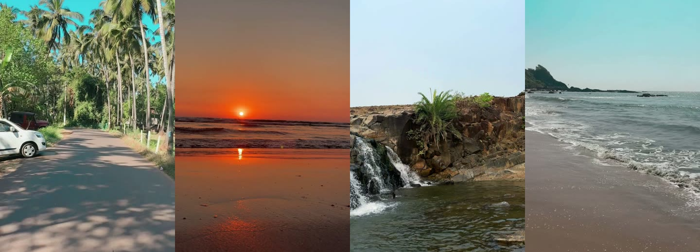
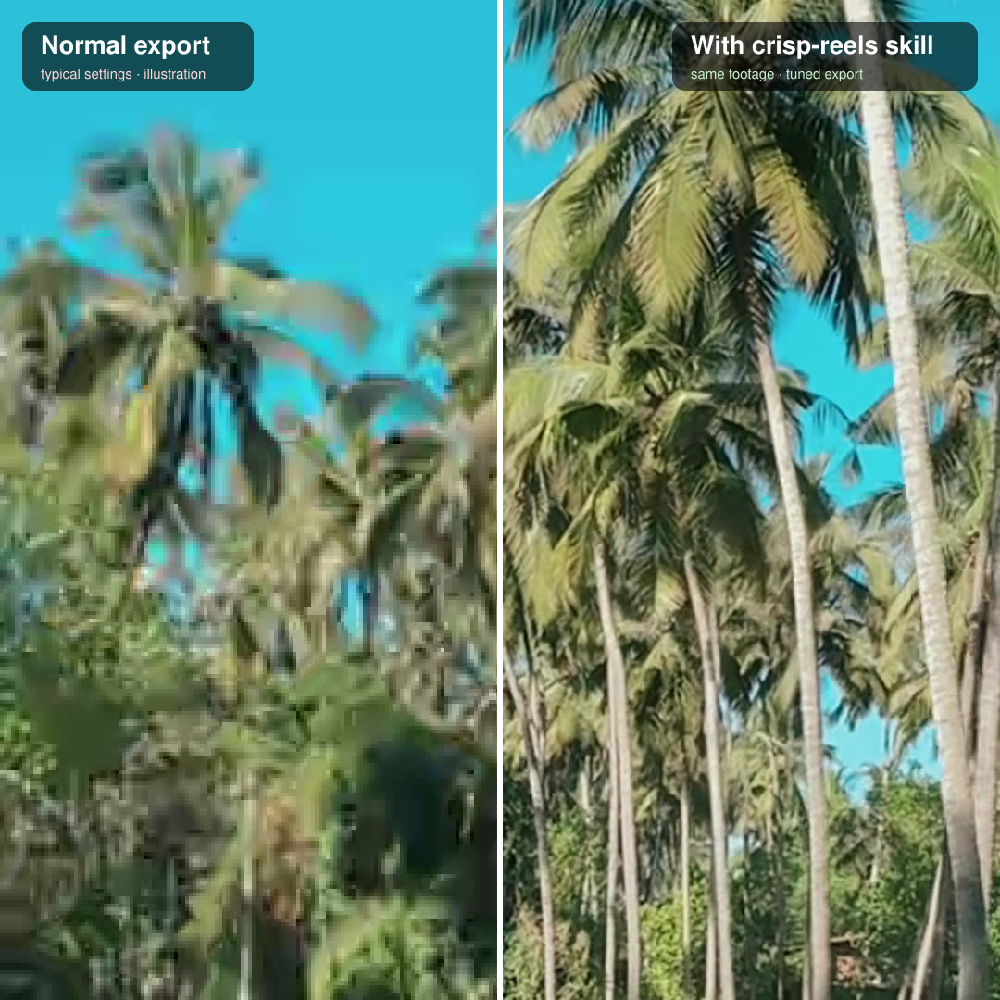
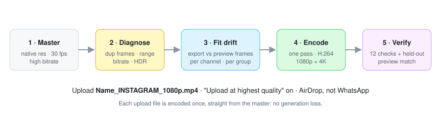
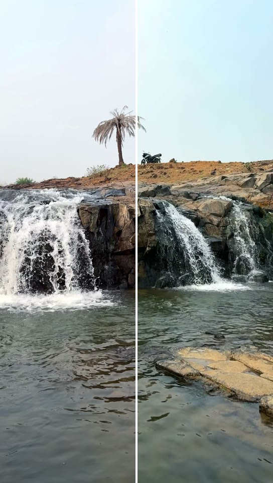
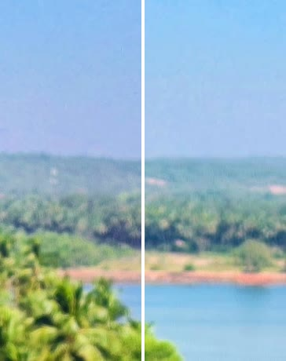
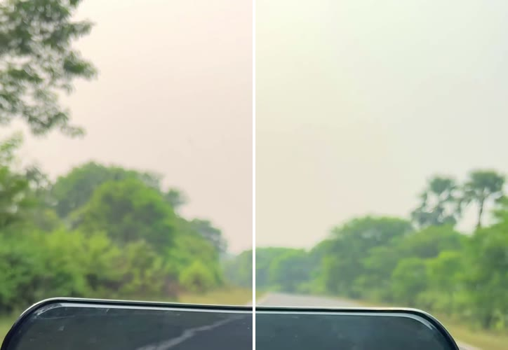
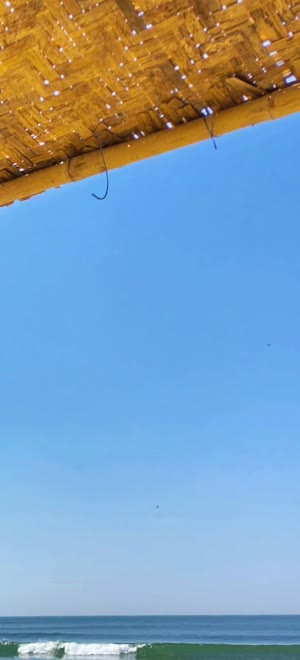
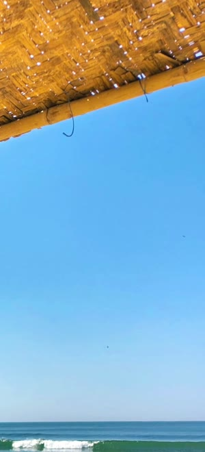
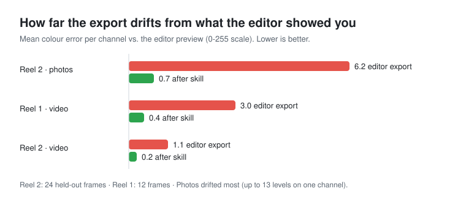

<p align="center">
  
</p>

<h1 align="center">crisp-reels-skill</h1>

<p align="center">
  <b>Your Reel looked perfect in the editor and soft, grey or blotchy on Instagram?</b><br>
  A Claude Code skill that finds out why, fixes it, and gives you one clean upload file.
</p>

<p align="center">
  
  
  
  
</p>

---

<p align="center">
  
</p>
<p align="center"><sub>Same footage. A few export settings make the difference between mush and crystal clear.</sub></p>

## The problem

Most "it got downgraded after export" problems aren't Instagram's fault. They come from a few silent mistakes in the export chain, and they stack:

| What goes wrong | What you see |
|---|---|
| Project set to **60 fps** with 30 fps footage | Every frame duplicated, half the bitrate wasted, soft motion |
| **Full-range** colour (`yuvj420p`) in the export | Washed-out or crushed, blotchy shadows when a player reads it as standard range |
| **Export colour drifts from the editor preview** | Greyer, warmer, less green than what you approved |
| 4K footage **downscaled early**, then upscaled by the canvas | Fine detail gone before Instagram even sees it |
| Re-encoding an already compressed file several times | Blocking, smeared texture |

## What the skill does

<p align="center"></p>

1. **Master:** gets the best export the editor can make (native resolution, 30 fps, high bitrate).
2. **Diagnose:** `diagnose.py` reports duplicated frames, real versus tagged colour range, bitrate, HDR and audio, in plain words.
3. **Fit drift:** `fit_drift.py` compares the export with frames from the editor's **own preview** and fits a per-channel correction. It can fit separate corrections for different kinds of content (for example photos versus video).
4. **Encode:** `encode.sh` makes the upload file in **one pass** from the master: 1080×1920, H.264, 30 fps, TV-range BT.709, about 20 Mbps. It also makes a 4K alternative when the master is really 4K.
5. **Verify:** `verify.py` runs 12 pass/fail checks. The correction is then confirmed on preview frames it was **not** fitted on.

Then it hands you the upload checklist ("Upload at highest quality", AirDrop rather than WhatsApp, and so on), because that matters as much as the file.

## Before / after

Left half: normal export. Right half: exported with the skill. Same frame, same footage.

<table>
  <tr>
    <td align="center"><br><sub><b>Waterfall</b>: clean water and sky, true colours</sub></td>
    <td align="center"><br><sub><b>Lagoon</b>: no more flat, grey photos</sub></td>
  </tr>
  <tr>
    <td align="center" colspan="2"><br><sub><b>Greenery</b>: natural greens, no red cast</sub></td>
  </tr>
</table>

<table>
  <tr>
    <th>Normal export</th>
    <th>With the skill</th>
  </tr>
  <tr>
    <td></td>
    <td></td>
  </tr>
</table>

## Measured, not eyeballed

<p align="center"></p>

Tested on two real reels:

- **Reel 1 (4K footage):** the normal export ran at 60 fps with doubled frames and full-range colour, and shifted colours away from the editor preview. With the skill, it's within 0.6 of the preview on every channel.
- **Reel 2 (1080p footage, video plus photos):** photos came out of the normal export flat and grey, each by a different amount. The skill corrects each one separately: the error drops from 6.2 to 0.7 for photos and from 1.1 to 0.2 for video.

## Install

Requires `ffmpeg`/`ffprobe` on your PATH and `python3` (standard library only).

**Claude Code (plugin, recommended):** inside a session, run

```
/plugin install crisp-reels --marketplace ashifali3147/crisp-reels-skill
```

On older Claude Code versions, add the marketplace first, then install:

```
/plugin marketplace add ashifali3147/crisp-reels-skill
/plugin install crisp-reels@crisp-reels-skill
```

**Manual / other agents:** the skill is a standard `SKILL.md` folder, so it also works in other agents that read Agent Skills (Codex CLI, Cursor, Gemini CLI, Copilot and others). Copy the folder into that agent's skills directory, for Claude Code:

```bash
git clone https://github.com/ashifali3147/crisp-reels-skill.git
cp -r crisp-reels-skill/skills/instagram-export ~/.claude/skills/
```

The main workflow only needs a shell with ffmpeg and Python. The optional Edits-app guide needs the Edits desktop app's `metapilot-native` MCP server connected to your agent; without it, export from Edits by hand and the rest of the skill works the same.

That's it. It loads automatically when you say things like:

> "my reel looks blurry after export"
> "make this video Instagram-ready"
> "best export settings for reels, it looks fine in CapCut but bad on insta"

## Use the scripts on their own

The scripts work without Claude too:

```bash
S=skills/instagram-export/scripts
python3 $S/diagnose.py master.mp4
python3 $S/fit_drift.py master.mp4 --pair 3=preview_03s.png --pair 9=preview_09s.png --out drift.json
bash    $S/encode.sh master.mp4 out/ MyReel --lut "$(python3 -c 'import json;print(json.load(open("drift.json"))["filter"])')"
python3 $S/verify.py out/MyReel_INSTAGRAM_1080p.mp4 --master master.mp4
```

`fit_drift.py` needs a few stills of the editor's preview at known timeline times: editor frame grabs, or screenshots of the paused preview cropped to the video. Leave out the correction if you have none; everything else still applies.

## Works with

Any editor that can export a high-quality master: CapCut, VN, Premiere Pro, DaVinci Resolve, Final Cut, InShot, Edits. There's an extra guide for **Meta's Edits app** driven through its automation (MCP) tools in [`references/edits-app.md`](skills/instagram-export/references/edits-app.md). It covers the 60 fps default canvas, HEVC-only export, the exact export settings it accepts, and its photo drift.

## What it doesn't do

- **Colour grading or editing.** It preserves the look you approved; it doesn't create one.
- **Bypass Instagram's compression.** Instagram always re-encodes. This makes sure it starts from the best possible file.

## License

[MIT](LICENSE)
